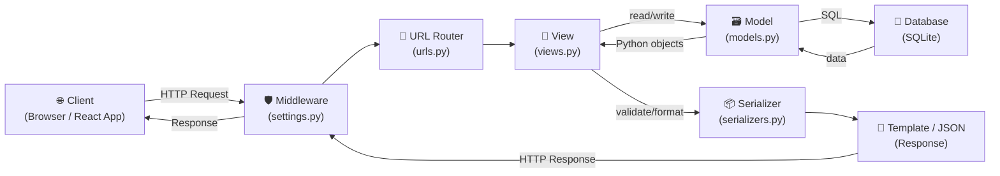
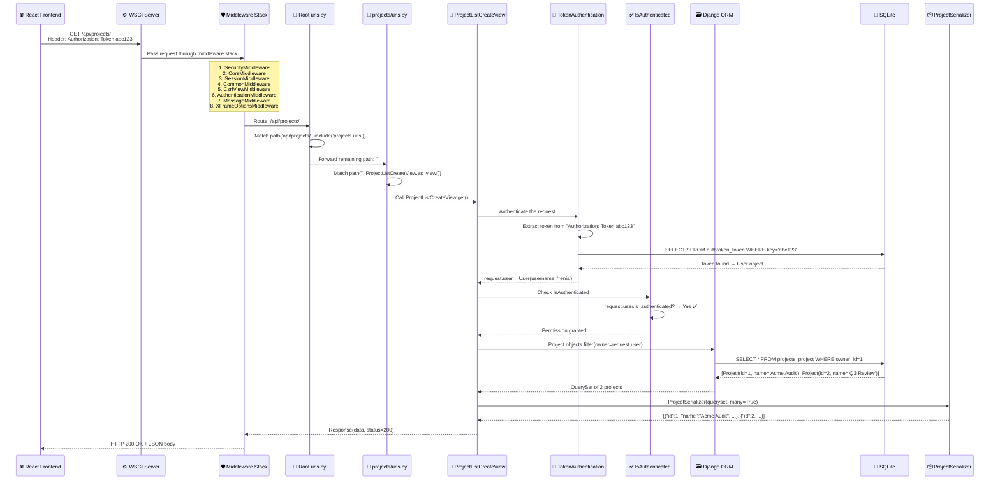
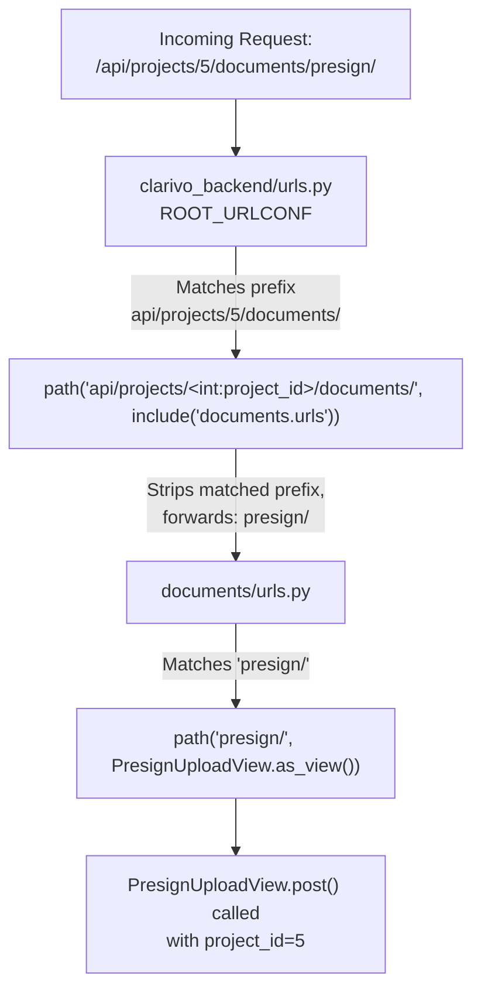
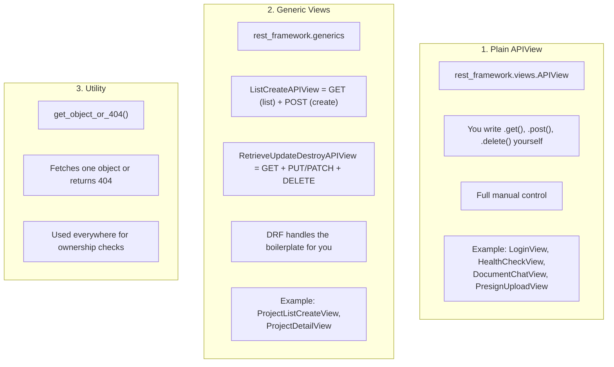
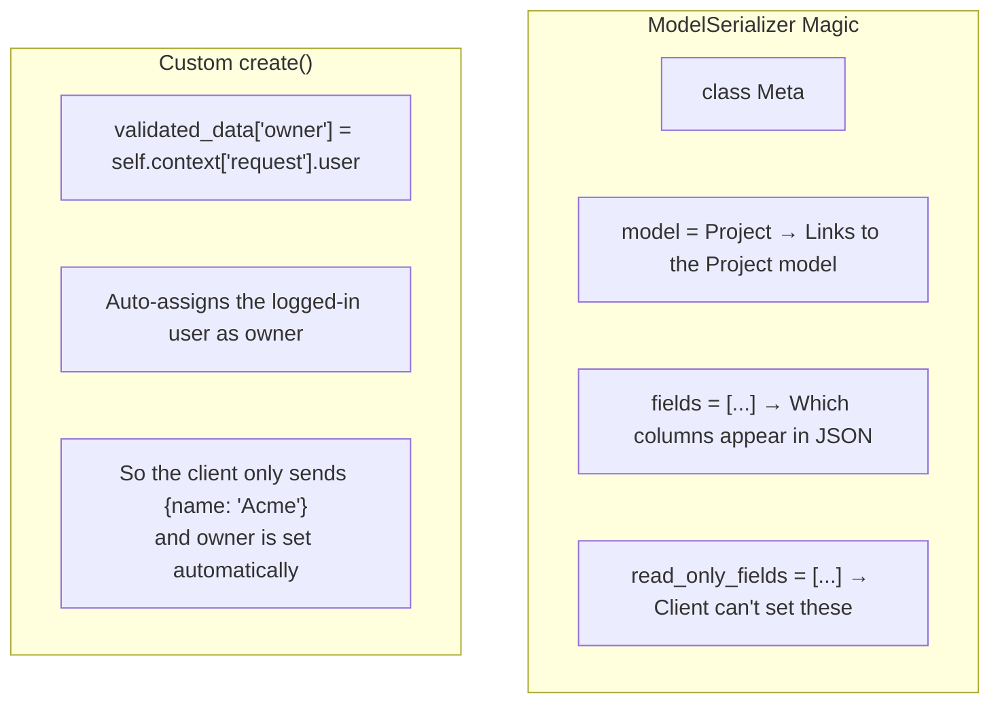
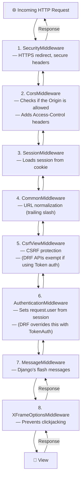
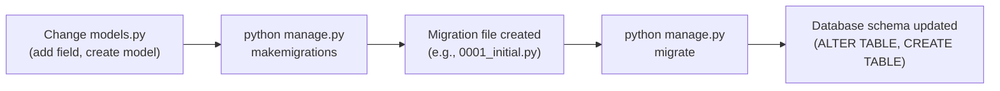
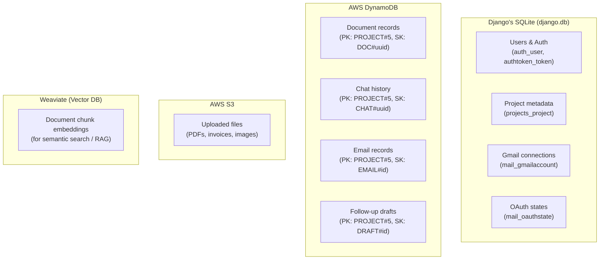
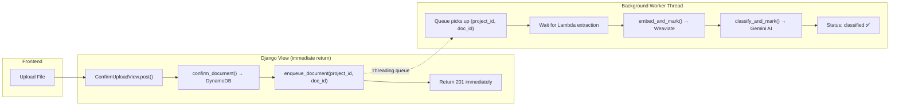

# 🎯 Django Interview Prep — Clarivo Project

> **Goal**: Be able to confidently explain every Django concept used in Clarivo,
> draw architecture diagrams on paper, and write minimal working code snippets
> when asked in the Infosys Specialist Programmer L1 interview.

---

## Table of Contents

1. [What is Django? — 30-Second Elevator Pitch](#1-what-is-django)
2. [The MVT Architecture (Model–View–Template)](#2-the-mvt-architecture)
3. [Project Structure — How Clarivo is Organised](#3-project-structure)
4. [The Full Request → Response Lifecycle](#4-the-full-request-response-lifecycle)
5. [URL Routing — How Django Finds the Right View](#5-url-routing)
6. [Views — The Brain of Every API Endpoint](#6-views)
7. [Models & the ORM — Talking to the Database](#7-models--the-orm)
8. [Serializers — Input Validation + Output Formatting](#8-serializers)
9. [Authentication & Permissions](#9-authentication--permissions)
10. [Middleware — The Pipeline Every Request Passes Through](#10-middleware)
11. [Settings — The Central Config File](#11-settings)
12. [Django Admin](#12-django-admin)
13. [Custom Management Commands](#13-custom-management-commands)
14. [WSGI / ASGI — How Django Serves HTTP](#14-wsgi--asgi)
15. [Migrations — Syncing Models with the Database](#15-migrations)
16. [CORS — Letting the Frontend Talk to the Backend](#16-cors)
17. [External Services (S3, DynamoDB, Weaviate)](#17-external-services)
18. [Background Processing (Threading)](#18-background-processing)
19. [Complete API Route Map](#19-complete-api-route-map)
20. [Ready-to-Write Code Snippets](#20-ready-to-write-code-snippets)
21. [Common Interview Questions & Answers](#21-common-interview-questions--answers)
22. [Quick Revision Cheatsheet](#22-quick-revision-cheatsheet)

---

## 1. What is Django?

> **One-liner you can say in the interview:**
> "Django is a high-level Python web framework that follows the batteries-included
> philosophy — it gives you an ORM, URL routing, authentication, an admin panel,
> and middleware out of the box, so you can build secure web applications fast."

**Key points to mention:**

| Point | Detail |
|---|---|
| Language | Python |
| Pattern | MVT (Model–View–Template), which is Django's version of MVC |
| ORM | Built-in Object-Relational Mapper — you write Python, it generates SQL |
| Admin | Auto-generated admin panel from your models |
| Security | CSRF protection, SQL injection prevention, XSS protection built-in |
| DRF | Django REST Framework — a companion library for building REST APIs |

---

## 2. The MVT Architecture

> **Interview Tip**: If asked "What architecture does Django follow?", say **MVT** and
> immediately draw this:



### MVT vs MVC — How to explain:

| MVC (other frameworks) | MVT (Django) | In Clarivo |
|---|---|---|
| **Model** | **Model** | `projects/models.py` → `Project` model |
| **View** | **Template** | We don't use templates — we return **JSON** via DRF |
| **Controller** | **View** | `projects/views.py` → `ProjectListCreateView` |

> **Key difference**: In Django, the **View** is the controller (it has the logic).
> The **Template** is the presentation layer. Since Clarivo is a REST API, we
> skip templates and return JSON directly via DRF's `Response()`.

---

## 3. Project Structure — How Clarivo is Organised

```
Backend-Clarivo/
├── manage.py                    ← Entry point — runs the dev server, migrations, etc.
├── requirements.txt             ← All Python dependencies
├── db.sqlite3                   ← The SQLite database file
│
├── clarivo_backend/             ← The PROJECT (global config)
│   ├── __init__.py
│   ├── settings.py              ← All configuration lives here
│   ├── urls.py                  ← ROOT URL router — first stop for every request
│   ├── wsgi.py                  ← Entry point for production (sync) servers
│   └── asgi.py                  ← Entry point for async servers
│
├── accounts/                    ← APP: Login & authentication
│   ├── models.py                ← (empty — uses Django's built-in User model)
│   ├── views.py                 ← LoginView
│   └── urls.py
│
├── projects/                    ← APP: CRUD for Projects
│   ├── models.py                ← Project model (name, owner, created_at)
│   ├── serializers.py           ← ProjectSerializer
│   ├── views.py                 ← ListCreate, RetrieveUpdateDestroy views
│   ├── admin.py                 ← Registers Project in Django Admin
│   ├── cleanup.py               ← Deletes project data from S3, DynamoDB, Weaviate
│   └── urls.py
│
├── documents/                   ← APP: File upload, extraction, embedding
│   ├── views.py                 ← Presign, Confirm, List, Embed, Classify views
│   ├── dynamo.py                ← DynamoDB read/write helpers
│   ├── services.py              ← Pipeline stages (embed_and_mark, classify_and_mark)
│   ├── pipeline.py              ← Background worker thread + queue
│   ├── embeddings.py            ← Chunking + vector embedding
│   ├── weaviate_client.py       ← Weaviate vector DB integration
│   └── urls.py
│
├── detection/                   ← APP: Discrepancy detection (AI-powered)
│   ├── views.py                 ← CheckProjectView, DiscrepancyTableView
│   ├── services.py              ← run_detection() — the main check logic
│   ├── detect.py                ← Gemini API call for discrepancy detection
│   ├── classify.py              ← Gemini API call for document classification
│   ├── retrieval.py             ← RAG retrieval from Weaviate
│   ├── prompts.py               ← LLM prompt templates
│   ├── management/commands/     ← Custom Django management command
│   └── urls.py
│
├── chat/                        ← APP: Per-document AI chat
│   ├── views.py                 ← DocumentChatView, ChatSuggestionsView
│   ├── engine.py                ← answer_question() — RAG + Gemini
│   ├── retrieval.py             ← Vector search for chat context
│   ├── storage.py               ← Chat history in DynamoDB
│   └── urls.py
│
├── mail/                        ← APP: Gmail integration
│   ├── models.py                ← GmailAccount, OAuthState (Django models)
│   ├── views.py                 ← OAuth flow, sync, push webhook, followups
│   ├── admin.py                 ← Admin for GmailAccount, OAuthState
│   ├── urls.py                  ← Gmail connection endpoints
│   ├── project_urls.py          ← Per-project mail thread endpoints
│   ├── followup_urls.py         ← Per-project followup endpoints
│   ├── gmail_client.py          ← Gmail API wrapper
│   ├── oauth.py                 ← OAuth helper functions
│   ├── sync.py                  ← sync_mailbox() — incremental Gmail sync
│   ├── ingest.py                ← Process emails into documents
│   ├── routing.py               ← Route emails to correct project
│   ├── parsing.py               ← Email body parsing
│   ├── background.py            ← Background sync worker
│   ├── storage.py               ← DynamoDB email/draft storage
│   ├── crypto.py                ← Fernet encrypt/decrypt for refresh tokens
│   ├── followups.py             ← Follow-up email generation
│   └── prompts.py               ← LLM prompts for email classification
│
├── api/                         ← APP: Health check endpoint
│   ├── views.py                 ← HealthCheckView
│   └── urls.py
│
└── lambda_functions/            ← AWS Lambda for document extraction
    └── extraction/
        ├── handler.py
        ├── Dockerfile
        └── requirements.txt
```

### Project vs App — How to explain:

> **Interview answer**: "A Django **project** is the whole web application — it has the
> global settings, the root URL config, and the WSGI/ASGI entry point. An **app** is
> a pluggable module that does one thing — like handling authentication, or managing
> projects. In Clarivo, `clarivo_backend` is the project, and `accounts`, `projects`,
> `documents`, `detection`, `chat`, and `mail` are the apps."

---

## 4. The Full Request → Response Lifecycle

> **This is the #1 thing interviewers ask.** Be able to draw this on paper.

### Visual Flow — What happens when the frontend calls `GET /api/projects/`



### Step-by-Step Walkthrough (for verbal answer):

1. **React** sends `GET /api/projects/` with `Authorization: Token abc123`
2. **WSGI server** (`python manage.py runserver`) receives the raw HTTP
3. **Middleware** runs in order — CORS check, session loading, CSRF check, etc.
4. **Root `urls.py`** matches `/api/projects/` and delegates to `projects/urls.py`
5. **App `urls.py`** matches the empty remaining path to `ProjectListCreateView`
6. **DRF** calls `TokenAuthentication` — looks up the token in the DB, sets `request.user`
7. **DRF** calls `IsAuthenticated` — checks `request.user.is_authenticated`
8. **View's `get_queryset()`** runs → `Project.objects.filter(owner=request.user)`
9. **ORM** translates to SQL → `SELECT * FROM projects_project WHERE owner_id = 1`
10. **Serializer** converts the QuerySet to JSON
11. **Response** travels back through middleware → sent to React

---

## 5. URL Routing

### How It Works



### The Root URL Configuration (Clarivo):

```python
# clarivo_backend/urls.py
from django.urls import path, include

urlpatterns = [
    path('admin/', admin.site.urls),                                    # Django Admin
    path('api/', include('api.urls')),                                   # Health check
    path('api/auth/', include('accounts.urls')),                         # Login
    path('api/gmail/', include('mail.urls')),                            # Gmail OAuth
    path('api/projects/', include('projects.urls')),                     # CRUD projects
    path('api/projects/<int:project_id>/documents/', include('documents.urls')),
    path('api/projects/<int:project_id>/mail/', include('mail.project_urls')),
    path('api/projects/<int:project_id>/followups/', include('mail.followup_urls')),
    path('api/projects/<int:project_id>/', include('detection.urls')),
    path('api/projects/<int:project_id>/documents/<str:doc_id>/chat/', include('chat.urls')),
]
```

### Key concepts to explain:

| Concept | What it does | Example |
|---|---|---|
| `path()` | Maps a URL pattern to a view | `path('login/', LoginView.as_view())` |
| `include()` | Delegates to another `urls.py` file | `include('projects.urls')` |
| `<int:project_id>` | URL parameter — captured as `int`, passed to view as `project_id` | `/api/projects/5/` → `project_id=5` |
| `<str:doc_id>` | URL parameter — captured as `str` | `/.../<uuid>/chat/` → `doc_id='<uuid>'` |
| `.as_view()` | Converts a class-based view into a callable | Required for class-based views in `path()` |

---

## 6. Views — The Brain of Every API Endpoint

> **Interview answer**: "A view is a Python function or class that takes an HTTP
> request and returns an HTTP response. In Clarivo, we use Django REST Framework's
> class-based views."

### Three Types of Views Used in Clarivo:



### Example 1: Plain `APIView` (LoginView)

```python
from rest_framework.views import APIView
from rest_framework.response import Response
from rest_framework import status
from django.contrib.auth import authenticate
from rest_framework.authtoken.models import Token

class LoginView(APIView):
    def post(self, request):
        username = request.data.get('username')     # DRF parses JSON body → request.data
        password = request.data.get('password')

        if not username or not password:
            return Response(
                {"error": "Please provide both username and password."},
                status=status.HTTP_400_BAD_REQUEST     # 400
            )

        user = authenticate(username=username, password=password)  # Django's built-in

        if user is not None:
            token, created = Token.objects.get_or_create(user=user)
            return Response({"token": token.key})      # 200 by default
        else:
            return Response(
                {"error": "Invalid username or password."},
                status=status.HTTP_400_BAD_REQUEST
            )
```

**What to explain:**
- `APIView` → you manually define HTTP methods (`.get()`, `.post()`, `.delete()`)
- `request.data` → DRF's parsed body (works for JSON, form data, etc.)
- `authenticate()` → Django built-in that checks username/password against the DB
- `Token.objects.get_or_create()` → ORM method: get the existing token or create a new one
- `Response()` → DRF's HTTP response (auto-converts dicts to JSON)

### Example 2: Generic View (ProjectListCreateView)

```python
from rest_framework import generics
from rest_framework.permissions import IsAuthenticated
from rest_framework.authentication import TokenAuthentication
from .models import Project
from .serializers import ProjectSerializer

class ProjectListCreateView(generics.ListCreateAPIView):
    serializer_class = ProjectSerializer
    authentication_classes = [TokenAuthentication]
    permission_classes = [IsAuthenticated]

    def get_queryset(self):
        return Project.objects.filter(owner=self.request.user)
```

**What to explain:**
- `ListCreateAPIView` → gives you **GET** (list all) and **POST** (create one) for free
- You just tell it: which serializer, which authentication, which permissions, which queryset
- DRF generates all the DB queries, validation, and response formatting automatically
- `get_queryset()` → **filters** so each user sees only their own projects

### Example 3: Generic View with Custom Destroy (ProjectDetailView)

```python
class ProjectDetailView(generics.RetrieveUpdateDestroyAPIView):
    serializer_class = ProjectSerializer
    authentication_classes = [TokenAuthentication]
    permission_classes = [IsAuthenticated]

    def get_queryset(self):
        return Project.objects.filter(owner=self.request.user)

    def destroy(self, request, *args, **kwargs):
        instance = self.get_object()       # Gets the Project or 404
        project_id = instance.pk

        deleted, errors = delete_project_data(project_id)  # Clean S3, DynamoDB, Weaviate

        if errors:
            return Response({"detail": "Could not delete..."}, status=status.HTTP_502_BAD_GATEWAY)

        instance.delete()                   # Django ORM: DELETE FROM projects_project WHERE id=5
        return Response(status=status.HTTP_204_NO_CONTENT)
```

**What to explain:**
- `RetrieveUpdateDestroyAPIView` → gives GET (detail), PUT/PATCH (update), DELETE (destroy)
- We override `destroy()` to clean up external services before deleting the row
- `self.get_object()` → fetches the one object by PK from the queryset (or 404)
- `instance.delete()` → ORM: runs `DELETE FROM projects_project WHERE id=...`

### Summary Table — View Types:

| Generic View | HTTP Methods it Provides | Used In Clarivo |
|---|---|---|
| `ListCreateAPIView` | GET (list), POST (create) | ProjectListCreateView |
| `RetrieveUpdateDestroyAPIView` | GET (detail), PUT/PATCH, DELETE | ProjectDetailView |
| `APIView` | Whatever you define | LoginView, HealthCheckView, all Document/Chat/Mail views |

---

## 7. Models & the ORM — Talking to the Database

### What is a Model?

> **Interview answer**: "A model is a Python class that maps to a database table.
> Each attribute of the class is a column. Django's ORM translates Python operations
> on models into SQL queries automatically."

### The Project Model (Clarivo's primary Django model):

```python
from django.db import models
from django.contrib.auth.models import User

class Project(models.Model):
    name = models.CharField(max_length=255)
    owner = models.ForeignKey(User, on_delete=models.CASCADE, related_name="projects")
    created_at = models.DateTimeField(auto_now_add=True)

    def __str__(self):
        return self.name
```

### What each line means:

| Code | What It Does | Database Equivalent |
|---|---|---|
| `class Project(models.Model)` | Creates a table called `projects_project` | `CREATE TABLE projects_project (...)` |
| `name = models.CharField(max_length=255)` | A string column, max 255 chars | `name VARCHAR(255) NOT NULL` |
| `owner = models.ForeignKey(User, ...)` | A foreign key to the User table | `owner_id INTEGER REFERENCES auth_user(id)` |
| `on_delete=models.CASCADE` | If the User is deleted, delete their Projects too | `ON DELETE CASCADE` |
| `related_name="projects"` | Access from User: `user.projects.all()` | (reverse relation) |
| `auto_now_add=True` | Auto-set to current time on creation | `DEFAULT CURRENT_TIMESTAMP` |
| `def __str__(self)` | What to show in admin & print() | (not a DB column) |

### GmailAccount Model (more complex example):

```python
class GmailAccount(models.Model):
    user = models.OneToOneField(User, on_delete=models.CASCADE, related_name="gmail_account")
    email = models.EmailField(unique=True)
    refresh_token_encrypted = models.TextField()
    access_token = models.TextField(blank=True)
    token_expiry = models.DateTimeField(null=True, blank=True)
    history_id = models.CharField(max_length=64, blank=True)
    watch_expiration = models.DateTimeField(null=True, blank=True)
    last_synced_at = models.DateTimeField(null=True, blank=True)
    needs_reconnect = models.BooleanField(default=False)
    connected_at = models.DateTimeField(auto_now_add=True)

    @property
    def refresh_token(self):
        return decrypt(self.refresh_token_encrypted)

    @refresh_token.setter
    def refresh_token(self, value):
        self.refresh_token_encrypted = encrypt(value)
```

### New concepts here:

| Concept | Explanation |
|---|---|
| `OneToOneField` | Each User has exactly ONE GmailAccount (1:1 relationship) |
| `unique=True` | No two rows can have the same email |
| `blank=True` | Django forms/serializers allow empty value |
| `null=True` | Database allows NULL |
| `@property` | Python property — `account.refresh_token` decrypts on read |
| `@refresh_token.setter` | `account.refresh_token = "abc"` encrypts before storing |

### ORM Cheatsheet — The Queries You Should Know:

```python
# CREATE — Insert a new row
project = Project.objects.create(name="Acme Audit", owner=user)

# READ — Get all
projects = Project.objects.all()

# READ — Filter
my_projects = Project.objects.filter(owner=request.user)

# READ — Get single or 404
project = get_object_or_404(Project, pk=5)

# READ — Get single (raises DoesNotExist if missing)
project = Project.objects.get(pk=5)

# UPDATE — Change and save
project.name = "New Name"
project.save()

# DELETE
project.delete()

# get_or_create — Get if exists, else create
token, created = Token.objects.get_or_create(user=user)
# created = True if new, False if already existed

# COUNT
total = Project.objects.filter(owner=user).count()

# CHAINING
recent = Project.objects.filter(owner=user).order_by('-created_at')[:5]

# EXISTS (returns bool — more efficient than counting)
has_clash = GmailAccount.objects.filter(email=email).exclude(user=user).exists()
```

### The Translation — Python to SQL:

```
Project.objects.filter(owner=request.user)
→ SELECT * FROM projects_project WHERE owner_id = 1;

Project.objects.get(pk=5)
→ SELECT * FROM projects_project WHERE id = 5;

project.delete()
→ DELETE FROM projects_project WHERE id = 5;

Token.objects.get_or_create(user=user)
→ SELECT * FROM authtoken_token WHERE user_id = 1;
  (if none) → INSERT INTO authtoken_token (key, user_id) VALUES ('abc123', 1);
```

---

## 8. Serializers — Input Validation + Output Formatting

> **Interview answer**: "A serializer converts complex data (like Django model instances)
> into Python native datatypes that can be rendered into JSON, and also validates
> incoming data before saving it to the database. It's like a two-way translator
> between your models and JSON."

### The ProjectSerializer:

```python
from rest_framework import serializers
from .models import Project

class ProjectSerializer(serializers.ModelSerializer):
    class Meta:
        model = Project
        fields = ['id', 'name', 'owner', 'created_at']
        read_only_fields = ['owner', 'created_at']

    def create(self, validated_data):
        validated_data['owner'] = self.context['request'].user
        return super().create(validated_data)
```

### What each part does:



### How Serialization Works:

```
═══ OUTGOING (Model → JSON) ═══

Project(id=1, name='Acme', owner=User(1), created_at='2026-10-13T...')
         ↓ ProjectSerializer(instance)
{"id": 1, "name": "Acme", "owner": 1, "created_at": "2026-10-13T..."}


═══ INCOMING (JSON → Model) ═══

Request body: {"name": "Acme Audit"}
         ↓ serializer = ProjectSerializer(data=request.data)
         ↓ serializer.is_valid(raise_exception=True)
         ↓ serializer.save()  →  calls create() or update()
Project row created in database
```

### Plain Serializer (not tied to a model):

```python
class PresignRequestSerializer(serializers.Serializer):
    filename = serializers.CharField(max_length=255)
    content_type = serializers.CharField(max_length=127)
```

> Used for **validation only** — when you're not saving to Django's DB.
> In Clarivo, document data goes to DynamoDB, not Django, so there's no Model.

### How validation is used in views:

```python
serializer = PresignRequestSerializer(data=request.data)
serializer.is_valid(raise_exception=True)  # Returns 400 if invalid
filename = serializer.validated_data["filename"]
```

---

## 9. Authentication & Permissions

### How Clarivo Does Auth:

```mermaid
flowchart TD
    subgraph "Step 1: Login"
        A["POST /api/auth/login/\n{username, password}"]
        B["Django's authenticate() checks DB"]
        C["Token.objects.get_or_create(user=user)"]
        D["Returns: {token: 'abc123'}"]
        A --> B --> C --> D
    end

    subgraph "Step 2: Every Subsequent Request"
        E["Header: Authorization: Token abc123"]
        F["TokenAuthentication reads the header"]
        G["Looks up token in authtoken_token table"]
        H["Sets request.user = the matching User"]
        I["IsAuthenticated checks request.user.is_authenticated"]
        E --> F --> G --> H --> I
    end
```



### Token Authentication — How it works:

1. Django has a built-in `authtoken_token` table (from `rest_framework.authtoken`)
2. When a user logs in, we create a token linked to their User
3. The frontend stores this token and sends it in every request header
4. `TokenAuthentication` reads the header, looks up the token, and sets `request.user`

### How every view enforces auth:

```python
class ProjectListCreateView(generics.ListCreateAPIView):
    authentication_classes = [TokenAuthentication]   # HOW to identify the user
    permission_classes = [IsAuthenticated]            # WHO is allowed in
```

| Attribute | Purpose | What happens if it fails |
|---|---|---|
| `authentication_classes` | Identifies the user from the request | `request.user` = AnonymousUser |
| `permission_classes` | Checks if the identified user is allowed | Returns 401 or 403 |

### Ownership Check Pattern (used everywhere):

```python
# "Show me only MY projects, not other people's"
def get_queryset(self):
    return Project.objects.filter(owner=self.request.user)

# "Give me this one project, but only if it's mine"
project = get_object_or_404(
    Project.objects.filter(owner=request.user),
    pk=project_id,
)
# If the project exists but belongs to someone else → 404 (not 403, to hide existence)
```

### Special Case — Public Endpoints:

```python
class GmailOAuthCallbackView(APIView):
    authentication_classes = []        # No token — Google redirects here
    permission_classes = [AllowAny]    # Anyone can hit this
```

---

## 10. Middleware — The Pipeline Every Request Passes Through

> **Interview answer**: "Middleware is a series of hooks that process every request
> before it reaches the view and every response before it reaches the client.
> Think of it as a layered pipeline — each layer can modify, block, or inspect
> the request/response."

### Clarivo's Middleware Stack:



### Key middleware to explain:

| Middleware | What It Does | Why Clarivo Needs It |
|---|---|---|
| `CorsMiddleware` | Allows React (port 5173) to call Django (port 8000) | Without it, browser blocks cross-origin requests |
| `CsrfViewMiddleware` | Prevents CSRF attacks | DRF with Token auth is exempt, but Django admin needs it |
| `AuthenticationMiddleware` | Attaches `request.user` from session | Base for Django admin; DRF overrides with its own auth |

### **IMPORTANT**: Middleware ordering matters!
`CorsMiddleware` must come **before** `CommonMiddleware` — otherwise CORS headers
aren't added to error responses, and the browser blocks them.

---

## 11. Settings — The Central Config File

> **Interview answer**: "settings.py is the single configuration file for the
> entire Django project. It defines the database, installed apps, middleware,
> authentication backends, and all external service credentials."

### Key Settings Explained:

```python
# Where to find the root URL router
ROOT_URLCONF = 'clarivo_backend.urls'

# All installed apps — Django scans these for models, admin, urls, etc.
INSTALLED_APPS = [
    'django.contrib.admin',          # Admin panel
    'django.contrib.auth',           # User model + authentication
    'django.contrib.contenttypes',   # Content type framework (for admin)
    'django.contrib.sessions',       # Session management
    'rest_framework',                # Django REST Framework
    'rest_framework.authtoken',      # Token authentication (authtoken_token table)
    'corsheaders',                   # CORS headers
    'accounts',                      # Our apps ↓
    'projects',
    'documents',
    'detection',
    'chat',
    'mail',
]

# Database — SQLite for development
DATABASES = {
    'default': {
        'ENGINE': 'django.db.backends.sqlite3',
        'NAME': BASE_DIR / 'db.sqlite3',
    }
}

# CORS — which origins are allowed
CORS_ALLOWED_ORIGINS = ['http://localhost:5173']  # Vite dev server

# Secret key — used for signing cookies, tokens, etc.
SECRET_KEY = 'django-insecure-...'  # NEVER use this in production

# Debug mode — shows detailed error pages
DEBUG = True  # Set to False in production

# Allowed hosts — which domain names can serve this app
ALLOWED_HOSTS = []  # Empty = only localhost in DEBUG mode
```

### Environment Variables:

```python
# Settings loads .env file using python-dotenv
from dotenv import load_dotenv
load_dotenv(BASE_DIR / '.env')

# Then reads values:
AWS_ACCESS_KEY_ID = os.environ.get('AWS_ACCESS_KEY_ID', '')
GOOGLE_CLIENT_ID = os.environ.get('GOOGLE_CLIENT_ID', '')
```

> **Why**: Secrets (API keys, DB passwords) should never be in source code.
> `.env` is in `.gitignore` so it's never committed.

---

## 12. Django Admin

> **Interview answer**: "Django Admin is an auto-generated web interface for managing
> your database. You register your models, and Django gives you a full CRUD
> interface with search, filtering, and pagination — zero frontend code needed."

### How Clarivo uses it:

```python
# projects/admin.py — Simple registration
from django.contrib import admin
from .models import Project
admin.site.register(Project)

# mail/admin.py — Customised registration
@admin.register(GmailAccount)
class GmailAccountAdmin(admin.ModelAdmin):
    list_display = ("email", "user", "needs_reconnect", "last_synced_at")
    list_filter = ("needs_reconnect",)
    search_fields = ("email", "user__username")
    fields = ("user", "email", "history_id", ...)  # Which fields show on the edit page
    readonly_fields = ("connected_at",)             # Can view but not edit
```

> **Security note**: In Clarivo's mail admin, `refresh_token_encrypted` and
> `access_token` are deliberately **excluded from fields** — never render
> credentials in HTML pages.

### Accessing admin:
```bash
python manage.py createsuperuser    # Create an admin user
python manage.py runserver          # Start server
# Visit http://localhost:8000/admin/
```

---

## 13. Custom Management Commands

> **Interview answer**: "Django management commands are custom CLI scripts that run
> with `python manage.py <command>`. They have full access to Django's ORM and
> settings, making them perfect for one-off tasks and data migrations."

### Clarivo's Custom Command:

```python
# detection/management/commands/backfill_supplier_emails.py
from django.core.management.base import BaseCommand

class Command(BaseCommand):
    help = "Extract supplier emails for documents that don't have them yet."

    def add_arguments(self, parser):
        parser.add_argument("project_id", help="The project PK to backfill.")

    def handle(self, *args, **options):
        project_id = options["project_id"]
        # ... does the work using ORM, DynamoDB, Gemini API
        self.stdout.write(self.style.SUCCESS("Done!"))
```

**Usage**: `python manage.py backfill_supplier_emails 5`

### Built-in commands you should know:
```bash
python manage.py runserver           # Start dev server
python manage.py makemigrations      # Generate migration files from model changes
python manage.py migrate             # Apply migrations to DB
python manage.py createsuperuser     # Create admin user
python manage.py shell               # Interactive Python shell with Django loaded
python manage.py startapp myapp      # Create a new app
```

---

## 14. WSGI / ASGI — How Django Serves HTTP

> **Interview answer**: "WSGI (Web Server Gateway Interface) is the standard for
> connecting Python web apps to web servers. `wsgi.py` is the entry point — it
> creates the Django application object that servers like Gunicorn or Apache call."

```python
# clarivo_backend/wsgi.py
import os
from django.core.wsgi import get_wsgi_application

os.environ.setdefault('DJANGO_SETTINGS_MODULE', 'clarivo_backend.settings')
application = get_wsgi_application()
```

| Protocol | File | When to Use |
|---|---|---|
| **WSGI** | `wsgi.py` | Synchronous — standard Django (what Clarivo uses) |
| **ASGI** | `asgi.py` | Asynchronous — for WebSockets, long polling |

### `manage.py` — The Development Entry Point:

```python
# manage.py
import os, sys

def main():
    os.environ.setdefault('DJANGO_SETTINGS_MODULE', 'clarivo_backend.settings')
    from django.core.management import execute_from_command_line
    execute_from_command_line(sys.argv)

if __name__ == '__main__':
    main()
```

> `DJANGO_SETTINGS_MODULE` is the critical env var — it tells Django which settings
> file to use. Both `manage.py` and `wsgi.py` set it.

---

## 15. Migrations — Syncing Models with the Database

> **Interview answer**: "Migrations are version-controlled instructions that Django
> generates from your model changes and applies to the database. They're like Git
> for your database schema."

### The Workflow:



### Example:

```bash
# 1. You add a field to your model:
#    name = models.CharField(max_length=255)
#    description = models.TextField(blank=True)    ← NEW

# 2. Generate the migration:
$ python manage.py makemigrations
# Creates: projects/migrations/0002_project_description.py

# 3. Apply it to the database:
$ python manage.py migrate
# Runs: ALTER TABLE projects_project ADD COLUMN description TEXT DEFAULT '';
```

### Key points:
- Migration files should be committed to Git (they're part of the codebase)
- `makemigrations` only generates the file — doesn't touch the DB
- `migrate` applies all unapplied migrations
- `django_migrations` table tracks which migrations have run

---

## 16. CORS — Letting the Frontend Talk to the Backend

> **Interview answer**: "CORS (Cross-Origin Resource Sharing) is a browser security
> feature that blocks requests from a different origin. Since our React frontend
> runs on port 5173 and Django runs on port 8000, they're different origins, so
> we need `django-cors-headers` to allow the frontend to make API calls."

```python
# settings.py
INSTALLED_APPS = [..., 'corsheaders', ...]

MIDDLEWARE = [
    ...,
    'corsheaders.middleware.CorsMiddleware',   # MUST be before CommonMiddleware
    'django.middleware.common.CommonMiddleware',
    ...,
]

CORS_ALLOWED_ORIGINS = [
    'http://localhost:5173',  # Only Vite dev server is allowed
]
```

---

## 17. External Services (S3, DynamoDB, Weaviate)

### Why Django's DB isn't enough:



> **Interview answer**: "We use a hybrid storage approach. Django's SQLite handles
> users, auth, and project metadata — structured relational data. DynamoDB stores
> document records, chat history, and emails — schema-flexible, high-throughput
> data. S3 stores the actual file bytes. And Weaviate stores vector embeddings
> for RAG (Retrieval-Augmented Generation) so the AI chat can find relevant
> document chunks."

### DynamoDB Access Pattern (Single Table Design):

```
Table: clarivo-documents
┌────────────────────┬────────────────────┬──────────────────────┐
│ PK (Partition Key) │ SK (Sort Key)      │ Other Attributes     │
├────────────────────┼────────────────────┼──────────────────────┤
│ PROJECT#5          │ DOC#uuid-1         │ filename, status, …  │
│ PROJECT#5          │ DOC#uuid-2         │ filename, status, …  │
│ PROJECT#5          │ CHAT#uuid-1#001    │ role, content, …     │
│ PROJECT#5          │ EMAIL#msg-id       │ subject, body, …     │
│ PROJECT#5          │ DRAFT#doc-id       │ to, subject, body, … │
└────────────────────┴────────────────────┴──────────────────────┘
```

---

## 18. Background Processing (Threading)

> **Interview answer**: "Clarivo uses a daemon thread with a queue for background
> document processing. When a file is uploaded, the view returns immediately and
> puts the document on a queue. A single worker thread picks it up and carries it
> through extraction → embedding → classification. This way the user doesn't wait."



---

## 19. Complete API Route Map

| Method | URL | View | What It Does |
|---|---|---|---|
| GET | `/api/health/` | `HealthCheckView` | Returns `{status: "ok"}` |
| POST | `/api/auth/login/` | `LoginView` | Returns auth token |
| GET | `/api/projects/` | `ProjectListCreateView` | List user's projects |
| POST | `/api/projects/` | `ProjectListCreateView` | Create a project |
| GET | `/api/projects/<id>/` | `ProjectDetailView` | Get one project |
| PATCH | `/api/projects/<id>/` | `ProjectDetailView` | Rename a project |
| DELETE | `/api/projects/<id>/` | `ProjectDetailView` | Delete project + all data |
| GET | `/api/projects/<id>/documents/` | `DocumentListView` | List documents |
| POST | `/api/projects/<id>/documents/presign/` | `PresignUploadView` | Get S3 upload URL |
| POST | `/api/projects/<id>/documents/confirm/` | `ConfirmUploadView` | Confirm upload |
| POST | `/api/projects/<id>/documents/<doc>/embed/` | `EmbedDocumentView` | Embed into Weaviate |
| POST | `/api/projects/<id>/documents/<doc>/classify/` | `ClassifyDocumentView` | Classify via Gemini |
| POST | `/api/projects/<id>/check/` | `CheckProjectView` | Run discrepancy detection |
| GET | `/api/projects/<id>/discrepancy-table/` | `DiscrepancyTableView` | Get results table |
| POST | `/api/projects/<id>/documents/<doc>/chat/` | `DocumentChatView` | Ask a question |
| GET | `/api/projects/<id>/documents/<doc>/chat/` | `DocumentChatView` | Get chat history |
| DELETE | `/api/projects/<id>/documents/<doc>/chat/` | `DocumentChatView` | Clear chat |
| GET | `/api/projects/<id>/documents/<doc>/chat/suggestions/` | `ChatSuggestionsView` | Get starter questions |
| GET | `/api/gmail/oauth/start/` | `GmailOAuthStartView` | Start Gmail connection |
| GET | `/api/gmail/oauth/callback/` | `GmailOAuthCallbackView` | OAuth callback |
| GET | `/api/gmail/status/` | `GmailStatusView` | Check Gmail connection |
| POST | `/api/gmail/push/` | `GmailPushView` | Pub/Sub push webhook |
| POST | `/api/gmail/sync/` | `GmailSyncNowView` | Manual sync |
| POST | `/api/gmail/disconnect/` | `GmailDisconnectView` | Disconnect Gmail |
| GET | `/api/projects/<id>/mail/threads/` | `MailThreadListView` | List email threads |
| GET | `/api/projects/<id>/mail/threads/<tid>/` | `MailThreadDetailView` | Thread messages |
| GET | `/api/projects/<id>/followups/` | `FollowupListView` | List follow-ups |
| GET/POST | `/api/projects/<id>/followups/<doc>/draft/` | `FollowupDraftView` | Get/create draft |
| POST | `/api/projects/<id>/followups/<doc>/send/` | `FollowupSendView` | Send follow-up |

---

## 20. Ready-to-Write Code Snippets

> **These are the minimal, interview-ready snippets** you can write on paper or
> whiteboard when asked "How would you build X in Django?"

### Snippet 1: "Create a REST API to list and create Blog Posts"

```python
# models.py
from django.db import models
from django.contrib.auth.models import User

class BlogPost(models.Model):
    title = models.CharField(max_length=255)
    content = models.TextField()
    author = models.ForeignKey(User, on_delete=models.CASCADE)
    created_at = models.DateTimeField(auto_now_add=True)

# serializers.py
from rest_framework import serializers
from .models import BlogPost

class BlogPostSerializer(serializers.ModelSerializer):
    class Meta:
        model = BlogPost
        fields = ['id', 'title', 'content', 'author', 'created_at']
        read_only_fields = ['author', 'created_at']

    def create(self, validated_data):
        validated_data['author'] = self.context['request'].user
        return super().create(validated_data)

# views.py
from rest_framework import generics
from rest_framework.permissions import IsAuthenticated
from rest_framework.authentication import TokenAuthentication

class BlogPostListCreateView(generics.ListCreateAPIView):
    serializer_class = BlogPostSerializer
    authentication_classes = [TokenAuthentication]
    permission_classes = [IsAuthenticated]

    def get_queryset(self):
        return BlogPost.objects.filter(author=self.request.user)

# urls.py
from django.urls import path
from .views import BlogPostListCreateView

urlpatterns = [
    path('posts/', BlogPostListCreateView.as_view(), name='post-list'),
]
```

### Snippet 2: "Write a login API that returns a token"

```python
from rest_framework.views import APIView
from rest_framework.response import Response
from rest_framework import status
from django.contrib.auth import authenticate
from rest_framework.authtoken.models import Token

class LoginView(APIView):
    def post(self, request):
        user = authenticate(
            username=request.data.get('username'),
            password=request.data.get('password'),
        )
        if user:
            token, _ = Token.objects.get_or_create(user=user)
            return Response({"token": token.key})
        return Response(
            {"error": "Invalid credentials"},
            status=status.HTTP_401_UNAUTHORIZED,
        )
```

### Snippet 3: "Write a model with a ForeignKey and make a migration"

```python
# models.py
from django.db import models
from django.contrib.auth.models import User

class Order(models.Model):
    customer = models.ForeignKey(User, on_delete=models.CASCADE, related_name="orders")
    total = models.DecimalField(max_digits=10, decimal_places=2)
    placed_at = models.DateTimeField(auto_now_add=True)

# Terminal:
# python manage.py makemigrations   ← generates the migration file
# python manage.py migrate          ← applies it to the DB
```

### Snippet 4: "Write a view that fetches data from DB and returns JSON"

```python
from rest_framework.views import APIView
from rest_framework.response import Response
from .models import Product

class ProductListView(APIView):
    def get(self, request):
        products = Product.objects.all().values('id', 'name', 'price')
        return Response(list(products))
```

### Snippet 5: "Write custom validation in a serializer"

```python
from rest_framework import serializers

class RegistrationSerializer(serializers.Serializer):
    username = serializers.CharField(max_length=150)
    email = serializers.EmailField()
    password = serializers.CharField(min_length=8, write_only=True)

    def validate_username(self, value):
        if User.objects.filter(username=value).exists():
            raise serializers.ValidationError("Username already taken.")
        return value

    def create(self, validated_data):
        return User.objects.create_user(**validated_data)
```

### Snippet 6: "Add a URL parameter and use it in a view"

```python
# urls.py
urlpatterns = [
    path('orders/<int:order_id>/', OrderDetailView.as_view()),
]

# views.py
class OrderDetailView(APIView):
    def get(self, request, order_id):          # order_id comes from the URL
        order = get_object_or_404(Order, pk=order_id)
        return Response({"id": order.id, "total": str(order.total)})
```

---

## 21. Common Interview Questions & Answers

### Q1: "What is Django REST Framework and why do you use it?"

> "DRF is a toolkit built on top of Django specifically for building REST APIs.
> It provides serializers for data validation and conversion, generic views that
> handle CRUD automatically, built-in authentication (Token, Session, JWT), and
> a browsable API for testing. In Clarivo, we use it because our frontend is a
> separate React app that communicates via JSON APIs — DRF makes building those
> APIs much faster than raw Django views."

### Q2: "What is the difference between `APIView` and `GenericAPIView`?"

> "`APIView` is the base class — you write everything manually: parse the request,
> query the database, build the response. `GenericAPIView` (and its mixins like
> `ListCreateAPIView`) automates most of that — you just tell it which model and
> serializer to use, and it handles listing, creating, updating, and deleting.
> In Clarivo, we use generic views for Projects (standard CRUD) and plain APIView
> for everything else (document uploads, OAuth, chat) because those have custom
> logic that doesn't fit the standard CRUD pattern."

### Q3: "How does Token Authentication work?"

> "When a user logs in, the server creates a random token string and stores it in
> a database table (`authtoken_token`) linked to that user. The token is returned
> to the client. For every subsequent request, the client sends it in the
> `Authorization: Token <key>` header. Django REST Framework's TokenAuthentication
> class reads this header, looks up the token in the DB, and sets `request.user`
> to the matching User object."

### Q4: "What is `get_object_or_404`?"

> "It's a Django shortcut that tries to fetch one object from the database. If it
> exists, it returns it. If it doesn't, it raises an `Http404` exception, which
> Django converts to a 404 response. In Clarivo, we use it everywhere to check
> that a project exists AND belongs to the requesting user — if someone tries to
> access another user's project, they get a 404 rather than a 403, which hides
> whether the resource even exists."

### Q5: "What's the difference between `ForeignKey` and `OneToOneField`?"

> "`ForeignKey` is a many-to-one relationship — many Projects can belong to one
> User. `OneToOneField` is exactly one-to-one — each User has exactly one
> GmailAccount. In the database, both create a column with a foreign key
> constraint, but `OneToOneField` adds a UNIQUE constraint on top."

### Q6: "What are migrations and why do they matter?"

> "Migrations are Python files that describe changes to the database schema — like
> 'add column X to table Y' or 'create table Z'. You generate them with
> `makemigrations` (reads your models and computes the diff) and apply them with
> `migrate` (runs the SQL against the database). They matter because they're
> version-controlled, so every developer on the team gets the same schema changes,
> and deployments can apply them automatically."

### Q7: "What is middleware and give an example?"

> "Middleware is code that runs on every request/response — before the view sees
> the request, and after the view returns the response. It's a pipeline: each
> middleware can modify, block, or inspect. In Clarivo, we use `CorsMiddleware`
> to add CORS headers so the React frontend on port 5173 can call the Django API
> on port 8000. Without it, the browser would block the requests."

### Q8: "How would you add a new field to an existing model?"

> "1) Add the field to the model class in `models.py`. 2) Run
> `python manage.py makemigrations` to generate the migration file. 3) Run
> `python manage.py migrate` to apply it. If the field is required (no default,
> not null), Django will ask you to provide a default value for existing rows."

### Q9: "What is CSRF and how does Django handle it?"

> "CSRF (Cross-Site Request Forgery) is when a malicious site tricks a user's
> browser into making a request to your site using their credentials. Django
> handles it with the `CsrfViewMiddleware`, which requires a CSRF token on every
> POST request. But in REST APIs using Token authentication (like Clarivo), CSRF
> protection is typically not needed because the token itself is the proof — it's
> not automatically sent by the browser like a cookie."

### Q10: "How is your project structured? Walk me through a request."

> "Clarivo has 6 Django apps: accounts (auth), projects (CRUD), documents (file
> upload + processing), detection (AI-powered discrepancy checking), chat
> (per-document AI chat), and mail (Gmail integration). When a request comes in —
> say `GET /api/projects/` — it first passes through 8 middleware layers (CORS,
> CSRF, auth, etc.), then the root `urls.py` matches the `/api/projects/` prefix
> and delegates to `projects/urls.py`, which matches the empty path to
> `ProjectListCreateView`. DRF's `TokenAuthentication` reads the auth header and
> identifies the user. `IsAuthenticated` ensures they're logged in. Then
> `get_queryset()` filters projects by owner, the `ProjectSerializer` converts them
> to JSON, and the response flows back through middleware to the client."

---

## 22. Quick Revision Cheatsheet

### 📋 The Files — What Goes Where:

| File | Purpose | Mnemonic |
|---|---|---|
| `settings.py` | All configuration | "The brain" |
| `urls.py` | URL → View mapping | "The receptionist" |
| `models.py` | Database tables | "The blueprint" |
| `views.py` | Request → Response logic | "The worker" |
| `serializers.py` | JSON ↔ Python conversion | "The translator" |
| `admin.py` | Admin panel registration | "The dashboard" |
| `apps.py` | App metadata | "The ID card" |
| `manage.py` | CLI entry point | "The boss" |
| `wsgi.py` | Production server entry | "The front door" |

### 🔑 Key Import Statements (memorize these):

```python
# Views
from rest_framework.views import APIView
from rest_framework import generics
from rest_framework.response import Response
from rest_framework import status

# Models
from django.db import models
from django.contrib.auth.models import User

# Serializers
from rest_framework import serializers

# Auth
from rest_framework.authentication import TokenAuthentication
from rest_framework.permissions import IsAuthenticated
from rest_framework.authtoken.models import Token
from django.contrib.auth import authenticate

# URLs
from django.urls import path, include

# Shortcuts
from rest_framework.generics import get_object_or_404
```

### ⚡ Status Codes Used in Clarivo:

| Code | Constant | When We Use It |
|---|---|---|
| 200 | `HTTP_200_OK` | Successful GET/POST (with data) |
| 201 | `HTTP_201_CREATED` | Successful creation (confirm upload) |
| 204 | `HTTP_204_NO_CONTENT` | Successful DELETE (nothing to return) |
| 400 | `HTTP_400_BAD_REQUEST` | Invalid input (bad login, validation fail) |
| 403 | `HTTP_403_FORBIDDEN` | Not allowed (bad push token) |
| 404 | `HTTP_404_NOT_FOUND` | Resource not found (or not yours) |
| 409 | `HTTP_409_CONFLICT` | Conflict (Gmail needs reconnect, doc not ready) |
| 502 | `HTTP_502_BAD_GATEWAY` | Upstream failure (S3/DynamoDB error during delete) |

### 🧠 Django ORM Quick Reference:

```python
Model.objects.all()                    # SELECT *
Model.objects.filter(field=value)      # SELECT * WHERE field = value
Model.objects.get(pk=1)                # SELECT * WHERE id = 1 (exactly one)
Model.objects.create(field=value)      # INSERT INTO ...
instance.save()                        # UPDATE ...
instance.delete()                      # DELETE ...
Model.objects.filter(...).count()      # SELECT COUNT(*)
Model.objects.filter(...).exists()     # SELECT EXISTS(...)
Model.objects.filter(...).exclude(...) # WHERE ... AND NOT ...
Model.objects.filter(...).order_by('x')# ORDER BY x
get_object_or_404(Model, pk=1)         # GET or raise Http404
Token.objects.get_or_create(user=u)    # GET or INSERT
```

---

> [!TIP]
> **Final Interview Tip**: When explaining Clarivo, always tie your Django knowledge
> to the actual project. Don't say "I used serializers" — say "I used a ModelSerializer
> for the Project model that auto-assigns the logged-in user as the owner during creation,
> so the client only needs to send the project name." That shows depth.

**Good luck tomorrow! 🚀**
